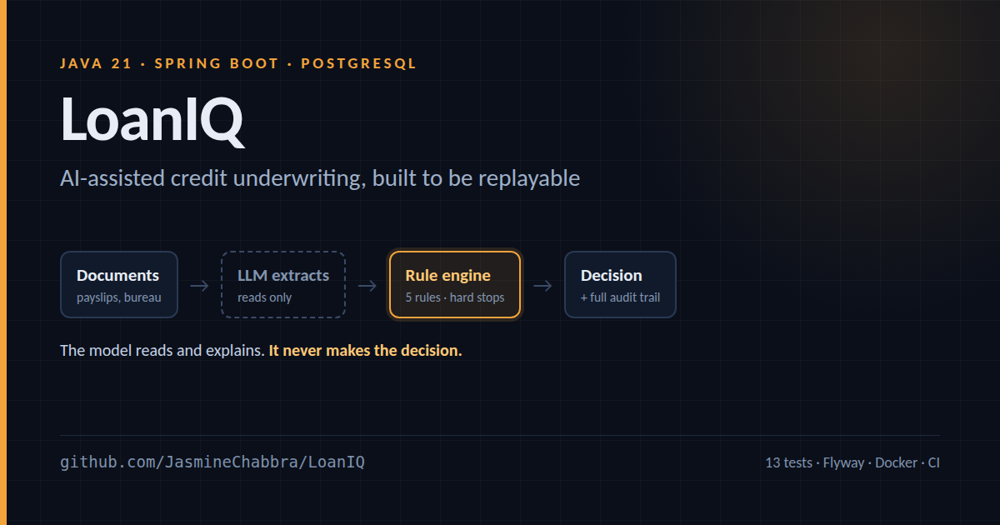

# LoanIQ



AI-assisted credit underwriting for digital lending — built so that every decision can be explained and replayed.

The interesting constraint in credit is not "can a model predict default". It is that a regulator can ask, two years later, *why this applicant was declined*, and the answer has to be the same every time you ask it. LoanIQ is built around that constraint.

**A language model reads documents and writes prose. It never makes the decision.** The decision comes from a deterministic rule engine whose thresholds live in configuration, and every rule that ran — including the ones that passed — is stored against the application.

---

## How a decision is made

```
POST /api/v1/applications
        │
        ▼
  ┌───────────────┐   documents present?
  │  Intake       │──────────────┐
  │  (idempotent) │              │
  └───────┬───────┘              ▼
          │              ┌──────────────────┐
          │              │ DocumentExtractor │  ← the only place a model runs
          │              │  income, EMI,     │     on input
          │              │  employment,      │
          │              │  bureau score     │
          │              └─────────┬────────┘
          │  declared figures      │ extracted facts override declared ones
          └────────────┬───────────┘
                       ▼
             ┌────────────────────┐
             │    RuleEngine      │   deterministic, ordered, no model
             │  BUREAU_MIN  (10)  │   hard stop
             │  DTI         (20)  │
             │  LTI         (30)  │
             │  EMPLOYMENT  (40)  │   hard stop
             │  TENURE      (50)  │   hard stop
             └─────────┬──────────┘
                       │  score + outcomes
                       ▼
             ┌────────────────────┐
             │  RationaleWriter   │  ← a model may phrase this, but it is
             │  (given the        │     given the decision, never asked
             │   decision)        │     to choose one
             └─────────┬──────────┘
                       ▼
                 AuditEvent rows
```

### Why the model is kept out of the decision

A model in the decision path would make the system unauditable: the same application could score differently on two runs, and nobody could tell a declined applicant what to change. Keeping the model on the edges buys the useful part — reading a messy payslip PDF — without giving up determinism.

The split shows up in the code as two narrow interfaces, `DocumentExtractor` and `RationaleWriter`. Both ship with a no-network default implementation, so the service runs end to end in CI and on a laptop with no API key.

---

## Design decisions worth calling out

**Idempotency is a first-class key, not a cache.** `Idempotency-Key` is a unique column on `loan_application`. A client that retries after a timeout gets the original decision back, not a second application with a possibly different answer. This is the difference between a retry being safe and a retry being a compliance incident.

**"Unknown" is a risk, not a pass.** A missing bureau score does not skip `BUREAU_MIN`; it scores `-40` and pushes the application toward REFER. Treating absent data as neutral is how thin-file fraud gets approved.

**Passing rules are stored too.** `rule_outcome` holds a row per rule per application, pass or fail. An audit that only shows failures cannot prove what was considered.

**Hard stops short-circuit but still report.** When a hard stop fires, scoring stops — but the outcomes already collected are returned, so the trail shows the full picture rather than one line.

**Thresholds live in config, validated at startup.** `UnderwritingProperties` is a validated record; `approveThreshold < referThreshold` fails the context rather than silently making REFER unreachable. A credit team can move a boundary without a release.

**Extraction failure degrades, it does not fail.** If the extractor throws, the application is still underwritten on declared figures and the failure is recorded. Losing an enrichment step should not lose the application.

**Money is `numeric(15,2)`.** Never a floating type. Totals have to be exact.

---

## Running it

```bash
docker compose up -d          # postgres + redis
mvn spring-boot:run
```

- API docs: http://localhost:8080/docs
- Health: http://localhost:8080/actuator/health
- Metrics: http://localhost:8080/actuator/prometheus

### Submit an application

```bash
curl -X POST http://localhost:8080/api/v1/applications \
  -H 'Content-Type: application/json' \
  -H 'Idempotency-Key: 4f9c2a1e-demo' \
  -d '{
    "applicantRef": "APP-1001",
    "applicantName": "A Borrower",
    "amountRequested": 300000,
    "tenureMonths": 36,
    "declaredMonthlyIncome": 90000,
    "monthlyObligations": 15000,
    "employmentType": "SALARIED",
    "bureauScore": 760,
    "documents": [
      { "kind": "payslip", "content": "ACME Corp payslip. Net monthly salary: 90,000.00. Bureau score: 760" }
    ]
  }'
```

The response carries the decision, the score, and every rule outcome behind it:

```json
{
  "decision": "APPROVE",
  "riskScore": 615,
  "rationale": "Approved with a risk score of 615. Every policy check passed.",
  "ruleOutcomes": [
    { "ruleCode": "BUREAU_MIN", "passed": true, "scoreDelta": 28, "explanation": "Bureau score 760 clears the floor of 620." },
    { "ruleCode": "DTI", "passed": true, "scoreDelta": 17, "explanation": "Debt-to-income 0.17 is within the 0.45 ceiling." }
  ]
}
```

Replay the full history:

```bash
curl http://localhost:8080/api/v1/applications/{id}/audit
```

---

## Wiring in a real model

Both AI seams are `@ConditionalOnMissingBean`. Supply a bean named `chatDocumentExtractor` or `chatRationaleWriter` and it takes over; the defaults step aside.

```java
@Bean("chatDocumentExtractor")
DocumentExtractor chatDocumentExtractor(ChatClient client) {
    return docs -> client.prompt()
            .user(u -> u.text("Extract income, EMI, employment and bureau score. Leave a field null if it is not clearly stated.")
                        .param("docs", docs))
            .call()
            .entity(DocumentExtraction.class);
}
```

The contract the replacement must honour: **leave a field null rather than guess.** The rule engine is built to treat unknown as risk, and that only works if the extractor is honest about what it could not read.

---

## Tests

```bash
mvn verify
```

`RuleEngineTest` covers the decision boundaries directly — hard stops, thin files, DTI and LTI penalties, and a determinism check that the same application scores identically twice. `UnderwritingServiceTest` runs the whole flow against an in-memory database, including idempotent replay and extracted facts overriding declared ones.

---

## Stack

Java 21 · Spring Boot 3.3 · Spring Data JPA · PostgreSQL · Flyway · Redis · springdoc-openapi · Micrometer/Prometheus · Testcontainers · JUnit 5 · Docker · GitHub Actions
